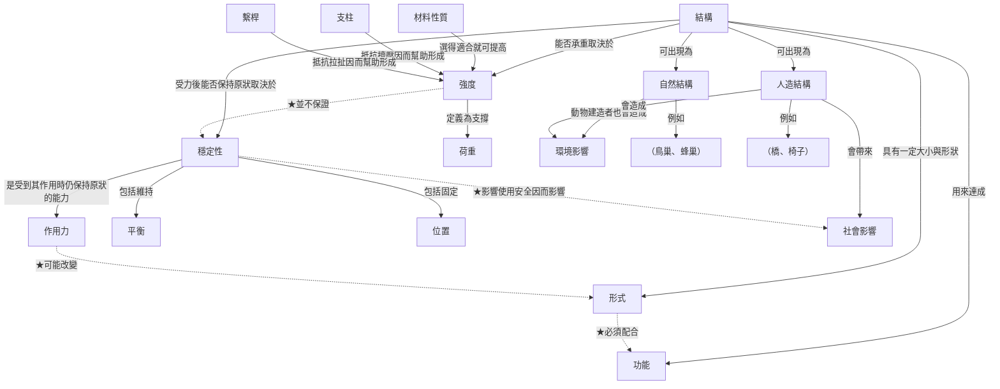

# 盲測 #01：安大略省三年級科學「堅固穩定的結構」
# Blind Test #01: Ontario Grade 3 Science — Strong and Stable Structures

**輸入 / Input：** [Novak 概念圖提示詞（正體中文）](../../prompts/novak-concept-map.zh-TW.md) + [課綱原文 / curriculum text](material.txt)
**平台 / Platform：** LMArena side-by-side，兩個模型同時作答 / two models answer the same input

先別看答案，讀完兩份輸出再自己判斷：哪一份更符合 Novak 概念圖理論？
Read both outputs before revealing the models. Which one follows Novak's concept-mapping theory better?

---

## 🅰️ 模型 A / Model A

> ⚠️ **備註：** 本模型的 Mermaid 概念圖直接以引號字串（如 `"結構"`）作為節點、未定義節點 ID，屬無效語法，無法渲染；原文未修改。

所走路由：路由 B（學期進度與課綱架構）｜執行版本：標準版  
選擇理由：輸入為 Ontario Curriculum Grades 1–8 Science and Technology (2022) Grade 3 之 Strand D 整體期望與具體期望，屬課綱條文與單元架構，非單課筆記或舊教案；故建立本單元宏觀概念網絡、錨點概念與命題演進。若需改為單課 50 分鐘備課，請回覆切換路由 A。

A. 輸入盤點與認知假設（Step 0）  
素材為安大略省小學三年級科學與科技課綱 Strand D「堅固與穩定的結構」，含 D1（科學科技與變遷世界之關聯：評估形式、功能、強度、穩定性對社會與環境之重要性）與 D2（概念理解：結構定義、形式與功能、強度、穩定性、材料性質、力的影響、支柱與拉桿）。本質為概念性＋部分程序性（如何增強／改善）知識，須以命題網絡呈現，而非流程圖。  
缺漏背景：未提供班級先備、實際時數、中文授課與否。假設：學段為小學三年級（Grade 3）；單元總時數約 8–12 節、每節約 40–50 分鐘；先備為低年級對日常物體「撐得住／站得穩」的具體經驗，以及 Strand A 之探究技能（觀察、比較、溝通）；語言以繁體中文對應課綱概念，保留英文術語。程序性部分（增加強度／穩定性的方式）改寫為「條件—動作—原理」命題，並標註屬程序節點。課綱代碼皆直接取自輸入，未編造。

B. 焦點問題：候選、選定與理由  
候選 1：為什麼有的結構能承載負荷且保持形狀，有的卻會倒塌或傾覆？  
候選 2：人類與動物建造的結構，其形式如何服務功能，又如何影響社會與環境？  
候選 3：材料性質、力、支柱與拉桿如何共同決定結構的強度與穩定性？  
選定：候選 2（最具統整性）。理由：同時涵蓋 D1 社會／環境評估與 D2 形式—功能—強度—穩定性核心，並能將自然／人造結構作為跨分支整合點，符合三年級探究深度且避免空泛的「什麼是結構」。

C. 概念停車場表格

| 概念 | 層級 | 類型 | 錨定於哪個先備概念 |
|------|------|------|---------------------|
| 結構 | 頂層 | 關鍵 | 日常「東西」（桌子、房子） |
| 承載框架 | 中層 | 關鍵 | 結構 |
| 負荷 | 中層 | 關鍵 | 重的東西／壓在上面 |
| 形式 | 中層 | 關鍵 | 形狀、大小 |
| 功能 | 中層 | 關鍵 | 用途 |
| 強度 | 中層 | 關鍵 | 撐得住 |
| 穩定性 | 中層 | 關鍵 | 站得穩、不倒 |
| 材料性質 | 中層 | 關鍵 | 硬／軟、厚／薄 |
| 力 | 中層 | 關鍵 | 推、拉、壓 |
| 支柱 | 底層機制 | 關鍵 | 撐住的桿子 |
| 拉桿 | 底層機制 | 關鍵 | 拉住的帶子／繩 |
| 自然環境結構 | 中層 | 關鍵 | 鳥巢、洞穴（具體經驗） |
| 人造環境結構 | 中層 | 關鍵 | 房子、橋、塔 |
| 社會影響 | 頂層側枝 | 關鍵 | 生活方便／安全 |
| 環境影響 | 頂層側枝 | 關鍵 | 對土地、動物、資源 |
| 動物建造的結構 | 底層 | 關鍵 | 自然環境結構 |
| （橋樑、塔、房屋） | 底層括號 | 範例 | 人造環境結構 |
| （鳥巢、海狸壩、蜂巢） | 底層括號 | 範例 | 動物建造的結構 |
| 重心／平衡（未在課綱明列為獨立概念） | — | 排除 | 超出 Grade 3 明示範圍 |
| 應力／應變等工程術語 | — | 排除 | 超出學段 |

納入圖中節點：16 個（不含括號實例）。

D. 命題矩陣

| 編號 | 概念 A | 精確關係詞 | 概念 B | 獨立語意完整句 | 階層關係 | 是否橫向連結（★） | 素材依據 |
|------|--------|------------|--------|----------------|----------|-------------------|----------|
| P1 | 結構 | 是一種具有確定大小、形狀與功能的 | 承載框架 | 結構是一種具有確定大小、形狀與功能、用來承載負荷的承載框架。 | 頂→中 | 否 | D2.1 |
| P2 | 承載框架 | 用來承載 | 負荷 | 承載框架用來承載負荷。 | 中→中 | 否 | D2.1 |
| P3 | 結構 | 出現在 | 自然環境結構 | 結構出現在自然環境中。 | 頂→中 | 否 | D2.1 |
| P4 | 結構 | 出現在 | 人造環境結構 | 結構出現在人造環境中。 | 頂→中 | 否 | D2.1 |
| P5 | 形式 | 服務於 | 功能 | 各種結構的形式服務於其功能。 | 中→中 | 否 | D2.2 |
| P6 | 強度 | 是結構承載負荷而不損壞的 | 能力 | 強度是結構承載負荷而不損壞的能力。 | 中層定義 | 否 | D2.3 |
| P7 | 穩定性 | 是結構在受力時保持形狀、平衡、漂浮或固定位置的 | 能力 | 穩定性是結構在受力時保持形狀、維持平衡、漂浮或固定在一處的能力。 | 中層定義 | 否 | D2.4 |
| P8 | 材料性質 | 必須在建造時被考慮以影響 | 強度 | 建造結構時必須考慮材料性質，因為它們影響強度。 | 中→中 | 否 | D2.5、D2.3 |
| P9 | 力 | 能改變結構的 | 形式 | 不同的力能改變結構的形狀（形式）。 | 中→中 | 否 | D2.6 |
| P10 | 力 | 能改變結構的 | 穩定性 | 不同的力能影響結構的平衡或位置，從而改變穩定性。 | 中→中 | 否 | D2.6、D2.4 |
| P11 | 支柱 | 在負荷下提供抗壓以增強 | 強度 | 支柱在負荷下提供抗壓支撐，從而增強結構強度。 | 底→中 | 否 | D2.7、D2.3 |
| P12 | 拉桿 | 在負荷下提供抗拉以增強 | 強度 | 拉桿在負荷下提供抗拉作用，從而增強結構強度。 | 底→中 | 否 | D2.7、D2.3 |
| P13 | 動物建造的結構 | 是 | 自然環境結構 | 動物建造的結構屬於自然環境中的結構。 | 底→中 | 否 | D1.2、D2.1 |
| P14 | 堅固穩定的結構 | 對社會與環境產生 | 社會影響 | 堅固與穩定的結構會對社會產生影響（如安全、居住）。 | 頂側 | 否 | D1.1 |
| P15 | 堅固穩定的結構 | 對社會與環境產生 | 環境影響 | 堅固與穩定的結構會對環境產生影響（如資源使用、棲地）。 | 頂側 | 否 | D1.1、D1.2 |
| P16 ★ | 形式 | 同時約束 | 強度 | 結構的形式同時約束其能達到的強度。 | 跨分支 | ★ | D2.2＋D2.3 整合 |
| P17 ★ | 動物建造的結構 | 其環境後果可對照 | 人造環境結構 | 動物建造的結構對環境的影響，可與人類建造的結構相對照評估。 | 跨自然／人造 | ★ | D1.2 |

E. Mermaid 概念圖

```mermaid
flowchart TB
    "結構" --> "承載框架"
    "承載框架" --> "負荷"
    "結構" --> "自然環境結構"
    "結構" --> "人造環境結構"
    "結構" --> "形式"
    "形式" --> "功能"
    "結構" --> "強度"
    "結構" --> "穩定性"
    "材料性質" --> "強度"
    "力" --> "形式"
    "力" --> "穩定性"
    "支柱" --> "強度"
    "拉桿" --> "強度"
    "動物建造的結構" --> "自然環境結構"
    "結構" --> "社會影響"
    "結構" --> "環境影響"
    "形式" -. 同時約束 .-> "強度"
    "動物建造的結構" -. 環境後果可對照 .-> "人造環境結構"
```

概念圖連結本為無向線段，此處箭頭方向僅為閱讀輔助之簡化。  
（實例置底層括號，未計入節點：人造如橋樑、塔、房屋；動物如鳥巢、海狸壩、蜂巢。）

請回覆『繼續』以輸出後半段

---

## 🅱️ 模型 B / Model B

所走路由:路由 B(學期進度與課綱架構)。執行版本:標準版(Step 0–5;本則只輸出 A–E)。

選擇理由:素材是安大略省 2022 年《Science and Technology》三年級 D 學習領域的整體期望與具體期望,屬課綱條文,不是單課筆記、網頁或舊教案。教師未另述意圖,故取涵蓋最完整的路由 B,把 D1 與 D2 當成同一學習領域內的兩個期望區塊來建宏觀概念圖。

如何切換:若只要一節課(預設 50 分鐘),請改走路由 A,並指定焦點期望(例如只做 D2.3–D2.4)。若要審查既有學習單或簡報,請改走路由 D 並貼上原件。若要即用材料庫、計分與 CSV,請指定完整版。

## A. 輸入盤點與認知假設(Step 0)

素材本質:這是 Grade 3「Strong and Stable Structures」的課綱期望,不是操作流程清單。結構被界定為承受荷重、具一定大小、形狀與功能的支撐框架;強度與穩定性是兩項可分開說明的性質;材料性質、作用力、支柱(strut)與繫桿(tie)是影響因素。D1 再要求評估強而穩的結構,以及動物與人類所造結構,對社會與環境的影響。概念性知識為主,「如何加強」屬程序性要求,已改寫進關係詞,不另設空泛的「方法」節點。

缺漏與處理假設(學段可由「Grade 3」推斷,故不中斷):
- 學段:Ontario Grade 3,約 8–9 歲,小學中年級。語言與鷹架按此調整,留待後半教學方案。
- 時長未給。假設本圖服務整個 D 學習領域(數週),不是單堂 50 分鐘。
- 先備未給。假設學生已有形狀、推與拉、常見材料、桌椅等生活經驗。一、二年級對應期望代碼未出現在素材中,標為待確認,不編造。
- 素材提及須整合 Strand A,但未附標題與條文。Strand A 的代碼與內容一律待確認,不寫入命題。
- 授課語言未給。本方案以繁體中文撰寫,節點附英文課綱用語;若實際以英語授課,請在回覆「繼續」時註明,後半改以英語課堂用語為主。
- 下列順序是教學設計假設,不是課綱規定的教學次序。課綱只要求「學年末」達成。

單元區塊與命題演進(路由 B):

| 區塊 | 課綱位置 | 本圖角色 | 錨點(先備或區塊間銜接) |
| --- | --- | --- | --- |
| D2 概念理解 | D2.1→D2.7 | 由「結構是什麼」分化到形式、功能、強度、穩定性、材料、力、支柱與繫桿 | 生活中的形狀、推拉、材料、日常物品;代碼待確認 |
| D1 與變動世界的關聯 | D1、D1.1、D1.2 | 用 D2 的概念去評估社會影響與環境影響 | 強度、穩定性、功能、自然結構、人造結構 |
| 其他學習領域 | Strand A、B、C | 不入圖 | 條文未附,待確認 |

核心命題演進(設計假設):先以 D2.1 界定結構,再以 D2.2 把形式連到功能,接著分開建立強度(D2.3、D2.5、D2.7)與穩定性(D2.4、D2.6),最後才用這些概念做 D1 的社會與環境評估。若先做 D1,學生只會用「好或壞」評價,缺少可檢驗的科學命題。

待確認、不編造:改善穩定性的具體工法(加寬底座、降低重心等)課綱要求學生「描述方法」,但本摘錄未列舉,故不寫成命題。支柱承受擠壓、繫桿承受拉扯,是結構學常規定義,不是本摘錄的原句。

## B. 焦點問題:候選、選定與理由

候選:
1. 一座給人走的橋,為什麼不能只是「看起來撐得住」,風一吹或人一推就可能倒下?
2. 若要做出撐得住荷重、受力也不易倒下,而且要對周圍環境負責的結構,形狀、用途、材料和力必須怎樣一起考慮?
3. 鳥巢和橋都是結構。它們怎樣撐住重量、保持不倒,又會怎樣影響周圍?

選定第 2 題。它同時罩住 D2 的形式、功能、強度、穩定性、材料與力,以及 D1 的環境責任,不是「什麼是結構」這類定義題。第 1 題過窄,第 3 題較適合作 D1.2 的子探究。

三年級課堂問法(與選定題同一焦點):「如果要做一個不會被壓垮、被推也不倒,而且不會隨便傷害周圍的結構,形狀、用途、材料和力要怎麼配合?」

## C. 概念停車場表格

最終入圖 16 個概念節點。括號實例不計入。新知識從標成錨點的生活概念長出。

| 概念 | 層級 | 類型(關鍵/範例/排除) | 錨定於哪個先備概念 |
| --- | --- | --- | --- |
| 結構 structure | 頂層 | 關鍵 | 日常「會撐住東西的物體」;年級代碼待確認 |
| 形式 form | 中層 | 關鍵 | 形狀、大小(生活經驗) |
| 功能 function | 中層 | 關鍵 | 「這個東西是用來做什麼的」 |
| 強度 strength | 中層 | 關鍵 | 「撐得住、壓不垮」 |
| 穩定性 stability | 中層 | 關鍵 | 站穩、不跌倒 |
| 荷重 load | 中層 | 關鍵 | 重物壓在物體上 |
| 作用力 force | 中層 | 關鍵;程序條件,非單純物件名稱 | 推與拉 |
| 自然結構 | 中層 | 關鍵 | 巢、蛛網等觀察 |
| 人造結構 | 中層 | 關鍵 | 桌椅、遊樂器材;課綱情境為 built environment |
| 材料性質 material properties | 底層 | 關鍵 | 常見材料(木材、塑膠等) |
| 支柱 strut | 底層;桿件角色,非流程步驟 | 關鍵 | 棒、柱可以撐住 |
| 繫桿 tie | 底層;桿件角色 | 關鍵 | 繩子可以拉住 |
| 平衡 balance | 底層 | 關鍵 | 身體站穩 |
| 位置 position | 底層 | 關鍵 | 東西停在哪裡 |
| 社會影響 effects on society | 底層 | 關鍵;新知識 | 建物給人使用 |
| 環境影響 environmental impact | 底層 | 關鍵;新知識 | 建造會改變周圍 |
| 鳥巢、蜂巢 | 底層實例 | 範例 | 自然結構 |
| 橋、椅子 | 底層實例 | 範例 | 人造結構 |
| 大小、形狀(獨立節點) | 不入圖 | 排除 | 併入 P1、P19,避免與「形式」重複 |
| 漂浮 | 不入圖 | 排除 | D2.4 的表現之一,併入 P4,不單列 |
| 重心、力矩 | 不入圖 | 排除 | 摘錄未列,或超出此次文字範圍 |
| 擠壓、拉扯(獨立節點) | 不入圖 | 排除 | 寫入 P9、P10 的關係詞 |
| 特定穩定性工法 | 不入圖 | 排除 | 摘錄未列舉,待確認,不編造 |
| Strand A 技能 | 不入圖 | 排除 | 條文未附,待確認 |

分支(供閱讀橫向連結,不是課綱官方分類):甲、形式;乙、強度及其因素;丙、穩定性與作用力;丁、功能、結構類型、社會影響與環境影響。

## D. 命題矩陣(Step 3)

關係詞若寫成「強度可藉由選用材料性質來提高」,獨立句已改寫成可念給同事聽的句子。P9、P10、P18、P20 的依據欄若寫「待複核」,表示它是整合或常規科學詮釋,不是課綱原句。

| 編號 | 概念 A | 精確關係詞 | 概念 B | 獨立語意完整句 | 階層關係 | 是否橫向連結(★) | 素材依據 |
| --- | --- | --- | --- | --- | --- | --- | --- |
| P1 | 結構 | 具有可辨認的大小與形狀,因而呈現特定 | 形式 | 結構具有可辨認的大小與形狀,因而呈現特定形式。 | 頂層→中層 | 否 | D2.1 |
| P2 | 結構 | 具有一定用途,用來達成特定 | 功能 | 結構具有一定用途,用來達成特定功能。 | 頂層→中層 | 否 | D2.1、D2.2 |
| P3 | 結構 | 能否承受荷重,取決於其 | 強度 | 結構能否承受荷重,取決於它的強度。 | 頂層→中層 | 否 | D2.3 |
| P4 | 結構 | 受力後能否保持形狀、平衡、漂浮或停在原位,取決於其 | 穩定性 | 結構受力之後,還能不能保持形狀、維持平衡、漂浮或停在原位,取決於它的穩定性。 | 頂層→中層 | 否 | D2.4 |
| P5 | 結構 | 若出現在自然環境中,即屬於 | 自然結構 | 出現在自然環境中的結構,屬於自然結構。 | 頂層→中層 | 否 | D2.1 |
| P6 | 結構 | 若由人類建在生活環境中,即屬於 | 人造結構 | 由人類建造、出現在建成環境中的結構,屬於人造結構。 | 頂層→中層 | 否 | D2.1;built environment 簡稱為人造結構 |
| P7 | 強度 | 是指支撐…的能力 | 荷重 | 強度是指結構支撐荷重的能力。 | 中層定義 | 否 | D2.3 |
| P8 | 材料性質 | 若選得適合承重,可以提高 | 強度 | 建造時若選用適合承重的材料性質,可以提高結構的強度。 | 底層因素→中層 | 否 | D2.3、D2.5 |
| P9 | 支柱 | 在荷重下抵抗擠壓,因而幫助形成 | 強度 | 支柱在結構承受荷重時抵抗擠壓,幫忙把荷重撐住,因此幫助形成強度。 | 底層→中層 | 否 | D2.7 只要求解釋角色;「抵抗擠壓」為常規定義,待複核 |
| P10 | 繫桿 | 在荷重下抵抗拉扯,因而幫助形成 | 強度 | 繫桿在結構承受荷重時抵抗拉扯,幫忙把構件拉住,因此幫助形成強度。 | 底層→中層 | 否 | D2.7;「抵抗拉扯」為常規定義,待複核 |
| P11 | 穩定性 | 包括受力時仍能維持 | 平衡 | 穩定性包括結構受力時仍能維持平衡的能力。 | 中層→底層 | 否 | D2.4 |
| P12 | 穩定性 | 包括受力時仍能固定 | 位置 | 穩定性包括結構受力時仍能停在原來位置的能力。 | 中層→底層 | 否 | D2.4 |
| P13 | 穩定性 | 是受到…時仍保持原狀的能力 | 作用力 | 穩定性是結構受到作用力時仍能保持原狀的能力。 | 中層內 | 否 | D2.4、D2.6 |
| P14 | 自然結構 | 其中由動物建造者,也會造成 | 環境影響 | 動物在自然環境中建造的結構,也會對環境造成影響。 | 中層→底層 | 否 | D1.2;「自然」不等於「無害」 |
| P15 | 人造結構 | 會造成可被評估的 | 環境影響 | 人類建造的結構,會造成可被評估的環境影響。 | 中層→底層 | 否 | D1.1、D1.2 |
| P16 | 人造結構 | 會對人群生活帶來 | 社會影響 | 人類建造的結構,會對人群生活帶來社會影響。 | 中層→底層 | 否 | D1.1 |
| P17 | 形式 | 必須配合結構要達成的 | 功能 | 結構的形式必須配合它要達成的功能。 | 甲→丁 | ★ | D2.2;D1 亦要求評估形式與功能的重要性 |
| P18 | 強度 | 很高,並不因此保證同樣具備 | 穩定性 | 結構的強度很高,並不因此保證它的穩定性也很高。 | 乙→丙 | ★ | D2.3 與 D2.4 分列;「不保證」是整合命題,待複核 |
| P19 | 作用力 | 可能改變結構的形狀,也就是改變其 | 形式 | 作用力可能改變結構的形狀,也就是改變它的形式。 | 丙→甲 | ★ | D2.6 |
| P20 | 穩定性 | 會影響人們能否安全使用結構,因此影響 | 社會影響 | 結構穩不穩定,會影響人們能否安全使用它,因而帶來有利或有害的社會影響。 | 丙→丁 | ★ | D1.1 與 D2.4 的整合,待複核 |
| P21 | 作用力 | 可能改變結構的 | 平衡 | 不同的作用力可能改變結構的平衡。 | 丙分支內 | 否 | D2.6 |
| P22 | 作用力 | 可能改變結構的 | 位置 | 不同的作用力可能改變結構的位置。 | 丙分支內 | 否 | D2.6 |

未寫成 ★、且故意不硬造的連結:「強度直接造成環境影響」。D1.1 的環境評估已由 P14、P15 承接。再拉一條「愈強愈環保」或「愈強愈傷環境」,方向都不穩,屬於膚淺連結。材料選用與環境的關係,摘錄也沒有寫成因果句,故不入圖。

「環境影響」「社會影響」對應 effects / impact,評估時可含有利與有害,不要預設只有破壞。

## E. Mermaid 概念圖(含 ★ 橫向連結)

本圖 16 個概念節點,未超過 20,不拆子圖。括號節點是實例,不計入 16。P21、P22 已在矩陣,與 P11–P13 同一分支,圖上不另畫兩條線,以免疊成蜘蛛網。



概念圖連結本為無向線段,此處箭頭方向僅為閱讀輔助之簡化。

跨期望交叉節點:形式—功能(D2.2)、強度—穩定性(D2.3×D2.4)、作用力—形式(D2.6)、穩定性—社會影響(D2.4×D1.1)。D1 與 D2 的銜接錨點是強度、穩定性、功能,不是另起一套「好結構」形容詞。

請回覆「繼續」以輸出後半段

**【學科知識真偽驗證提醒】本方案中的概念階層、因果關係詞與橫向交叉連結,係基於既有文本與認知邏輯建構。語言模型生成的語意關係表面上看似合理,但教學者在實際進入課堂前,必須針對該學科的科學共識、最新研究實證或官方審定標準,親自複核所有關鍵動詞與因果方向之正確性,切勿單憑文句通順即採信其學術真實性。**

---

<details>
<summary>🔓 揭曉模型 / Reveal the models</summary>

| | 模型 / Model |
|---|---|
| 🅰️ Model A | `grok-4.6-low` |
| 🅱️ Model B | `grok-4.7-xhigh` |

同門內戰：同一家族、不同版本與推理強度。
A Grok civil war: same family, different versions and reasoning effort.

</details>
